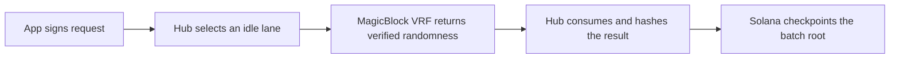

# Bakeland VRF Hub

**Shared MagicBlock randomness infrastructure for multiple applications**

Bakeland VRF Hub lets multiple apps share one deployed Solana program without
sharing application state. Each app receives an independent authority, lane
pool, request history, and ordered batch accumulator.

Teams integrate with a lane instead of rebuilding the complete VRF and
Ephemeral Rollup lifecycle. The Hub coordinates randomness only; loot rules,
payments, inventory, session policy, privacy, and settlement remain owned by
the consumer app.

## How a request moves

The callback is authenticated by the MagicBlock VRF SDK. A fulfilled lane is
not released until its exact request and nonce have been folded into the app's
ordered batch history.

## Why a shared Hub matters

- **Faster adoption:** an app integrates with a lane rather than engineering
  callback, concurrency, cancellation, and checkpoint infrastructure itself.
- **Shared deployment:** independent app authorities and PDAs reuse one program
  without sharing writable application state.
- **Operational learning:** multiple apps exercise the same narrow randomness
  coordinator, making monitoring and failure behavior easier to improve.
- **Clean boundaries:** game economics and asset custody stay in dedicated
  consumer programs where their rules can be audited independently.

## Capacity and measured proof

| Measure | Current evidence or limit |
| --- | --- |
| Lanes per app | Up to 64 |
| Requests in flight | Up to one per lane |
| Planning range | 128–640 requests/second at an illustrative 500–100 ms lane cycle |
| Devnet result | 1,004/1,004 calls across four concurrent lanes |
| Durable proof | Ten 100-result checkpoints in one session, final undelegation, rollover, and post-rollover use |

The throughput range is a planning illustration, not a benchmark. Actual
capacity depends on callback latency, RPC quality, operator behavior, consumer
work, and the number of active apps.

## Cost shape for 10,000 results

| Model | Batch lifecycle | Illustrative ER charges |
| --- | --- | ---: |
| Legacy lifecycle | Undelegate the batch account every 100 results | About `0.30 SOL` |
| Validated keepalive lifecycle | Ten 100-result commits, then rotate after 1,000 results | About `0.12 SOL`, or `$12` at `$100/SOL` |

The estimate uses MagicBlock pricing reviewed on 23 October 2026: VRF requests
and normal ER transactions were listed as free, with `0.003 SOL` for a
delegation session and `0.001 SOL` for each commit after the first. It excludes
Solana transaction fees, account rent, setup, eventual lane undelegation, and
operations. Pricing can change; the keepalive lifecycle was validated on
devnet on 6 November 2026.

## Recommended position

The Hub is ready to present as an open-source reference and controlled
shared-service pilot. It is not yet a permissionless mainnet service.

Before mainnet, the project still needs a safe consumer integration boundary,
admission and quotas, governed authorities, reproducible verified builds,
security review, failure injection, operational monitoring, and a longer
multi-app load test.

For deployment, integration, test commands, and the full mainnet checklist, see
[Instructions.md](../Instructions.md). Devnet transactions and batch roots are
recorded in [the keepalive evidence](DEVNET_KEEPALIVE1000_EVIDENCE_2026-11-06.md).
